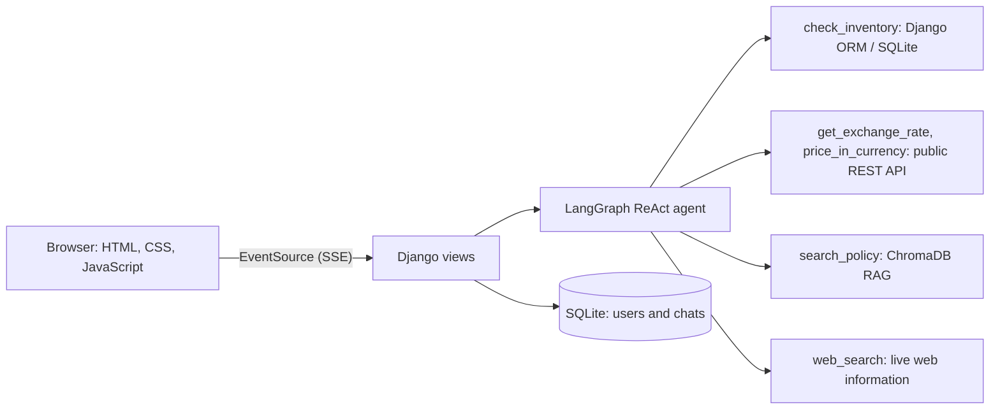

# Agentic Operations Assistant

An AI chat assistant for a laptop company's operations team, built with **Django** and a **LangGraph tool-calling agent**. It decides which tool to use (database, live API, document search, or web search), answers from the results, and shows every step behind its answer on request.

> **Note:** This is a personal learning and portfolio project. It is not affiliated with Lenovo or any company. All inventory and policy data in this repository is **sample data created for this project**.

  

## Demo

**Video walkthrough (about 1.5 minutes):** [Watch the demo](ADD_YOUR_VIDEO_LINK_HERE)


| Agent steps (three-dot menu) | Saved chats |
|---|---|
|  |  |

## Features

- **LLM agent (ReAct-style, LangGraph)** that chooses between five tools using function calling
- **RAG over documents:** policy files are split into chunks, embedded with Ollama, stored in ChromaDB, and retrieved with the source file name
- **Live data:** exchange rates from a public REST API and optional web search
- **Chat interface** with user registration and login, saved conversations in a sidebar, and short-term conversation memory
- **Transparent answers:** the answer box shows only the final reply; a three-dot menu reveals the question, tool calls, tool results and final answer
- **Streaming** of agent output to the browser using Server-Sent Events
- **Guardrails:** company facts come only from tools; if a tool finds nothing, the assistant says so and labels any extra help as general knowledge
- **Configurable LLM:** a cloud model through an API key, or a local Llama 3.2 model through Ollama (one setting in `.env`)

## How it works



1. The user sends a question from the chat page.
2. Django loads the last few messages of that conversation and starts the agent.
3. The agent decides whether to call a tool, reads the result, and writes the answer.
4. Steps are streamed to the browser and saved with the answer so old chats can be reopened.

## Tools

| Tool | Data source | Used for |
|---|---|---|
| `check_inventory` | Django ORM (SQLite) | Stock and USD price of a laptop |
| `get_exchange_rate` | Frankfurter REST API | Live currency rates |
| `price_in_currency` | Django ORM + REST API | A laptop's price in another currency (conversion done in Python, not by the model) |
| `search_policy` | ChromaDB (RAG) | Warranty, returns, RMA and procurement questions, with source file |
| `web_search` | Live web search | Current public laptop information |

## Tech stack

**Backend:** Python 3.12, Django, Django ORM, SQLite
**AI:** LangGraph, LangChain, Ollama (Llama 3.2, `nomic-embed-text` embeddings), ChromaDB
**Frontend:** HTML5, CSS3, JavaScript (EventSource)
**Tools:** Git, GitHub, VS Code, Claude (AI-assisted development)

## Project structure

```
.
├── agent/
│   ├── core.py            # tools, system prompt, agent, run_agent()
│   └── rag.py             # document loading, chunking, embeddings, ChromaDB search
├── chat/                  # views, URLs, Conversation and Message models
├── inventory/             # ProductInventory model
├── config/                # Django settings and root URLs
├── templates/             # chat.html, login.html, register.html
├── static/                # css/chat.css, js/chat.js
├── policies/              # sample policy documents used for RAG
├── experiments/           # early step-by-step learning scripts
├── seed.py                # sample inventory data
├── build_index.py         # builds the ChromaDB index
├── requirements.txt
└── .env.example
```

## Getting started

### Prerequisites
- Python 3.12
- [Ollama](https://ollama.com) installed and running
- A Google AI Studio API key (needed for web search and the cloud model option)

### Installation

```powershell
git clone https://github.com/Harman-singh012/agentic-operations-assistant.git
cd agentic-operations-assistant

python -m venv venv312
venv312\Scripts\activate          # macOS/Linux: source venv312/bin/activate
pip install -r requirements.txt

copy .env.example .env            # macOS/Linux: cp .env.example .env
# open .env and add your key

ollama pull nomic-embed-text      # embeddings for RAG
ollama pull llama3.2:3b           # only needed for LLM_PROVIDER=ollama

python manage.py migrate
python seed.py                    # sample inventory
python build_index.py             # index the policy documents
python manage.py runserver
```

Open http://127.0.0.1:8000, register an account and start chatting.

### Configuration (`.env`)

| Variable | Meaning | Example |
|---|---|---|
| `GOOGLE_API_KEY` | Google AI Studio key (web search and cloud model) | `your_key_here` |
| `LLM_PROVIDER` | `gemini` for the cloud model, `ollama` for local Llama 3.2 | `ollama` |
| `GEMINI_MODEL` | Cloud model name | `gemini-flash-latest` |

Never commit your real `.env` file. Only `.env.example` belongs in the repository.

## Example questions

| Question | What happens |
|---|---|
| How many Legion 5 are in stock? | Calls `check_inventory` and answers from the database |
| What is the price of Legion 5 in INR? | Calls `price_in_currency` (database price plus live rate) |
| Does the warranty cover a cracked screen? | Calls `search_policy`, answers from the policy text and shows the source file |
| What is the USD to INR rate? | Calls `get_exchange_rate` |
| Do you have a Dell XPS in stock? | Tool returns nothing, so the assistant says it has no company data on it |
| Hi, who are you? | Answers directly with no tool call |

## Design decisions and lessons learned

- **Small local models are unreliable with many tools.** A 3B model sometimes picked the wrong tool or ignored tool output. I improved this with short tool descriptions, labelled tool results (`FOUND` / `NOT_FOUND`), and moved currency conversion into a Python tool instead of asking the model to do arithmetic.
- **Prompts alone are not a guardrail.** Important checks are also enforced in code, for example labelling an answer as general knowledge when every company tool returned nothing.
- **Each user only sees their own chats.** Conversations are filtered by the logged-in user on every request.
- **External services fail.** Web search can hit API quota limits; the tool returns a clear message and the assistant handles it instead of inventing results.

## Known limitations

- Inventory and policy data are small sample datasets; stock numbers are not real.
- Web search depends on API quota and may be unavailable at times.
- Answer quality depends on the chosen model; the local 3B model is weaker than a cloud model at choosing tools.
- No automated evaluation suite yet (answers were tested manually with the questions above).
- Runs with Django's development server, not configured for production deployment.

## Roadmap

- Automated evaluation script with a pass rate for tool choice and answers
- Django REST Framework endpoint for the chat
- Markdown rendering and word-by-word streaming
- Docker setup and a hosted demo
- Import of a larger public laptop dataset

## How I used AI tools

I used Claude to help scaffold code, debug errors and learn concepts while building this project. I ran, tested and edited the code myself, and fixed the issues described above through testing.

## Author

**Harman Singh**
Second-year BCA student, India | AI application development and full-stack Python (Django)
GitHub: [Harman-singh012](https://github.com/Harman-singh012)
